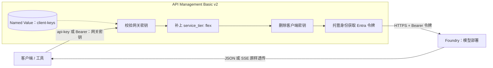
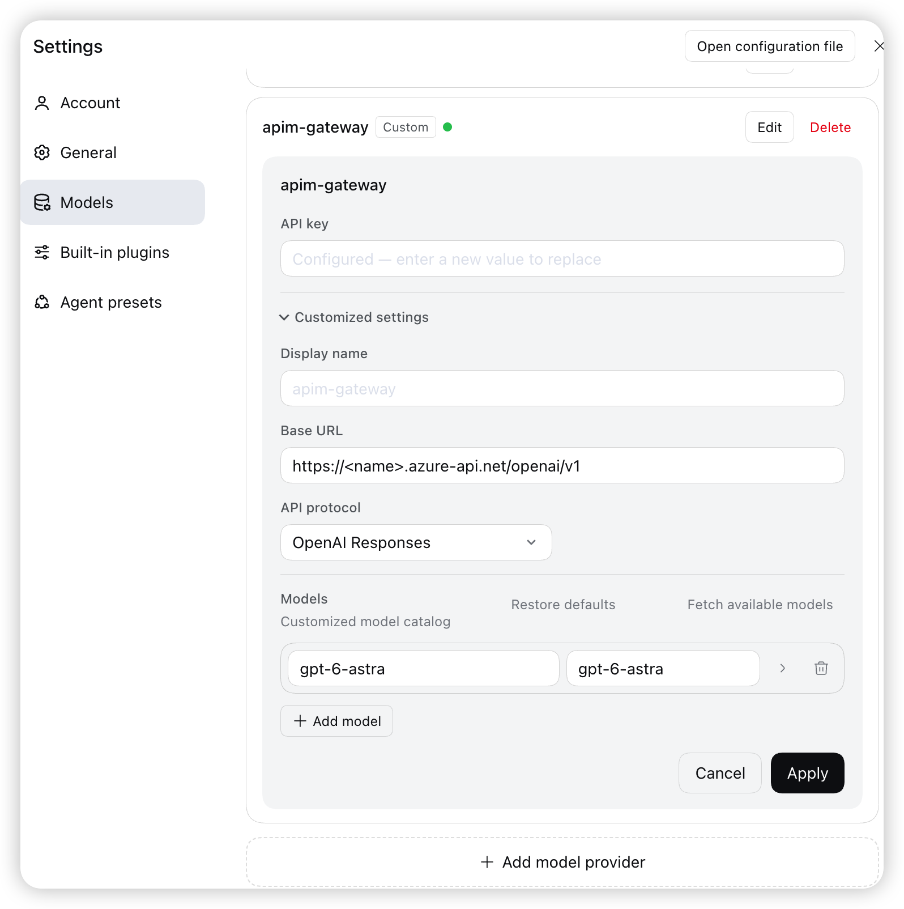

# 使用 Azure API Management 为 Foundry 模型自动启用低价 Flex 模式

Foundry 上的 GPT 模型支持 Flex 处理层级（预览版）：**Flex 的 token 价格比标准层级低 50%**，代价是响应时间更长、波动更大，偶尔会因容量不足返回 429。它适合评测、数据增强、离线分析、长程的编程任务和后台 Agent 等不追求实时的任务。启用方式是在请求 body 里加上 `service_tier: "flex"`，或者带上请求头 `x-ms-service-tier: flex`。问题在于，很多现成的工具和客户端并不提供这个参数的配置入口。

本文用 **Azure API Management（APIM）Basic v2** 做一个统一入口：网关在转发前自动为请求补上 `service_tier: "flex"`，客户端只需要把 Base URL 换成网关地址，不需要改代码。网关同时满足三点要求：**支持流式输出**、**同时接受 `api-key` 和 `Authorization: Bearer` 两种传 key 方式**、**后端使用托管身份访问 Foundry**。

> 本文聚焦网关的设计和 Policy 实现，不展开 APIM、Foundry 和模型部署的创建步骤。文中所有环境信息均使用占位符，需要替换为自己的配置。

## 目录

- [一、什么是 Flex 模式](#一什么是-flex-模式)
- [二、整体架构](#二整体架构)
- [三、关键设计](#三关键设计)
- [四、测试与验证](#四测试与验证)

---

## 一、什么是 Flex 模式

### 1.1 GPT 模型的三种处理层级

Foundry 上的 GPT 模型按处理层级区分为三种模式。它们使用**同一个 endpoint 和同一个模型部署**，区别只在于请求被分配到哪种算力上处理，以及按什么费率计费：

| 模式 | `service_tier` 取值 | 特点 | 价格 |
| --- | --- | --- | --- |
| 标准 | `default` | 默认层级，按量付费，响应时间稳定，适合大多数在线业务 | 基准价 |
| Priority | `priority` | 低延迟、更稳定的处理，适合对响应速度敏感的在线场景；可在部署级别默认开启，也可按请求选择 | 约为标准价的 **2 倍** |
| Flex | `flex` | 使用低优先级的空闲算力，延迟波动大，容量不足时可能返回 HTTP 429；适合评测、数据增强、离线分析等可容忍延迟的任务 | **低 50%**，缓存 token 的折扣同样适用 |

几点补充：

- **Priority 可能被降级为标准处理。** 在高峰时段、部分模型的长上下文请求（预估超过 128k prompt token），或者短时间内流量激增时，请求会按标准层级处理，响应中的 `service_tier` 显示为 `default`，并按标准价计费。
- **Flex 只对支持的模型生效。** 所选模型不支持 Flex 时，请求不会按 Flex 处理。
- 不传 `service_tier` 时，请求按部署的默认设置处理，通常为标准层级。

### 1.2 如何为请求启用 Flex

为单个请求启用 Flex 有两种方式，Responses API 和 Chat Completions API 都支持：

| 方式 | 写法 |
| --- | --- |
| 请求 body | 顶层字段 `"service_tier": "flex"` |
| 请求头 | `x-ms-service-tier: flex` |

两种方式效果相同。同时使用且取值不同时，以请求头为准。请求头的名称必须是 `x-ms-service-tier`，写成 `service-tier` 等其他名称会被忽略。

**本文后续均以 body 方式为例。** 以 Responses API 为例：

```json
{
  "model": "gpt-5.6-sol",
  "service_tier": "flex",
  "input": "总结这份会议纪要的三个要点"
}
```

Chat Completions API 的写法相同，同样放在 body 顶层：

```json
{
  "model": "gpt-5.6-sol",
  "service_tier": "flex",
  "messages": [
    { "role": "user", "content": "总结这份会议纪要的三个要点" }
  ]
}
```

服务端会在响应 body 中返回实际使用的层级，可以用来确认请求确实走了 Flex：

```json
{
  "id": "resp_...",
  "object": "response",
  "model": "gpt-5.6-sol",
  "service_tier": "flex",
  "status": "completed",
  "output": [ ... ],
  "usage": { ... }
}
```

流式请求同样会返回层级：Responses API 在第一个 `response.created` 事件的 `response.service_tier` 中给出；Chat Completions 在每个 chunk 的 `service_tier` 字段中给出。

---

## 二、整体架构

### 2.1 组件与调用关系



一次请求经过以下步骤：

1. 客户端向 APIM 发送请求，在 `api-key` 请求头或 `Authorization: Bearer` 中携带**网关密钥**。
2. APIM 从 Named Value `client-keys` 中比对密钥，不匹配直接返回 401，不会调用后端。
3. 对 JSON 格式的 POST 请求，如果 body 中没有 `service_tier`，补上 `"flex"`；客户端显式指定的值保持不变。
4. 删除客户端带来的密钥头，避免网关密钥被转发给后端。
5. APIM 用自己的系统托管身份获取 Entra ID 令牌，调用 Foundry。
6. Foundry 的 JSON 或 SSE 响应不经缓冲，直接返回给客户端。

### 2.2 对外提供的接口

网关的 API 路径为 `/openai`，后端指向 `https://<foundry-name>.services.ai.azure.com/openai`，`/openai/*` 下的请求按原路径转发。常用接口：

| 功能 | 方法 | 网关路径 |
| --- | --- | --- |
| Responses API | POST | `/openai/v1/responses` |
| Chat Completions API | POST | `/openai/v1/chat/completions` |

客户端使用的 Base URL 为：

```text
https://<apim-name>.azure-api.net/openai/v1
```

`model` 字段填写 Foundry 中的**部署名称**，例如 `gpt-5.6-sol`。

---

## 三、关键设计

### 3.1 自动补上 flex，保留客户端显式指定的值

网关在 inbound 阶段用 `set-body` 改写请求 body。只处理 JSON 格式的 POST 请求，GET 等其他请求原样转发：

```xml
<choose>
  <when condition="@(context.Request.Method == "POST" && context.Request.Headers.GetValueOrDefault("Content-Type", "").Contains("application/json"))">
    <set-body>@{
      var body = context.Request.Body.As<JObject>(preserveContent: true);
      if (body["service_tier"] == null) {
        body["service_tier"] = "flex";
      }
      return body.ToString(Newtonsoft.Json.Formatting.None);
    }</set-body>
  </when>
</choose>
```

- `preserveContent: true`：读取 body 后保留原始内容，便于后续策略或诊断再次访问。
- `body["service_tier"] == null`：**只在客户端没有指定时才补上**。某个请求需要标准层级时，客户端显式传 `"service_tier": "default"` 即可绕过 Flex。如果希望强制所有请求都走 Flex，去掉这个判断即可。客户端如果用 `x-ms-service-tier` 请求头指定了层级，由于请求头优先于 body，同样以客户端的选择为准。
- `Formatting.None`：输出紧凑 JSON，不额外增加请求体积。

### 3.2 支持流式：只改请求，不碰响应

流式输出能否实时到达，只取决于**响应**是否被缓冲。改写请求 body 发生在转发之前，请求本身很小，不影响流式。要保证的是响应原样透传：

```xml
<backend>
  <forward-request timeout="600" buffer-response="false" />
</backend>
<outbound>
  <base />
</outbound>
```

- `buffer-response="false"`：APIM 收到后端的 SSE 数据后立即转发，不等完整响应结束。
- outbound 中**不要读取响应 body**（例如 `context.Response.Body`、`set-body`、`find-and-replace`），否则 APIM 必须先缓冲完整响应。
- 如果开启了 Application Insights 等诊断日志，不要记录响应 body，原因相同。
- `timeout="600"`：Flex 的响应时间可能较长，超时比默认值留得更宽。

### 3.3 同时支持 api-key 和 Authorization: Bearer

很多 OpenAI 兼容工具只会用 `Authorization: Bearer <key>` 传密钥，而 APIM 内置的订阅校验只能从**指定名称的请求头或查询参数**中读取订阅密钥，不能解析 `Bearer` 前缀；而且这个校验发生在 Policy 之前，Policy 无法先做转换。

因此本方案关闭 API 的订阅校验（`subscriptionRequired: false`），改为在 Policy 中自行校验。允许的密钥保存在 **secret 类型的 Named Value `client-keys`** 中，多个密钥用逗号分隔。

先从两个位置提取密钥，`api-key` 优先：

```xml
<set-variable name="clientKey" value="@{
  var k = context.Request.Headers.GetValueOrDefault("api-key", "");
  if (string.IsNullOrEmpty(k)) {
    var auth = context.Request.Headers.GetValueOrDefault("Authorization", "");
    if (auth.StartsWith("Bearer ", StringComparison.OrdinalIgnoreCase)) {
      k = auth.Substring(7).Trim();
    }
  }
  return k;
}" />
```

再与 `client-keys` 比对，缺失或不匹配时直接返回 401，不调用后端：

```xml
<choose>
  <when condition="@{
    var k = (string)context.Variables["clientKey"];
    return string.IsNullOrEmpty(k) || Array.IndexOf("{{client-keys}}".Split(','), k) < 0;
  }">
    <return-response>
      <set-status code="401" reason="Unauthorized" />
      <set-header name="Content-Type" exists-action="override">
        <value>application/json</value>
      </set-header>
      <set-body>{"error":{"code":"401","message":"Invalid or missing key. Send it in the api-key header or as Authorization: Bearer."}}</set-body>
    </return-response>
  </when>
</choose>
```

`{{client-keys}}` 会在 Policy 运行前被替换为 Named Value 的值，客户端看不到这个列表。

这种做法有几点取舍：

- **密钥需要手动维护。** 新增、撤销密钥都通过修改 `client-keys` 完成。APIM 订阅密钥在门户里重新生成时，不会自动同步到这个列表。
- **失去订阅维度的内置能力。** 关闭订阅校验后，APIM 不再按订阅区分调用方，按订阅统计用量、按订阅限流等功能不再可用。
- **注意变更顺序。** 必须先发布包含密钥校验的 Policy，确认生效后再关闭订阅校验。顺序反了，网关会在一段时间内不做任何鉴权。

> 这个 401 响应的 `set-body` 是纯文本。XML 中不能出现未转义的 `<`、`>`，例如 `<key>` 会被解析成 XML 标签，导致 Policy 发布失败。

### 3.4 后端使用托管身份访问 Foundry

客户端的密钥只用于访问网关，转发前必须删除；然后由 APIM 的系统托管身份获取令牌，访问 Foundry：

```xml
<set-header name="api-key" exists-action="delete" />
<set-header name="Authorization" exists-action="delete" />
<authentication-managed-identity resource="https://cognitiveservices.azure.com" />
```

- 两个 `delete` 必须放在 `authentication-managed-identity` 之前。后者会重新写入 `Authorization: Bearer <Entra 令牌>`，如果顺序反了，托管身份的令牌会被删掉。
- APIM 的托管身份需要在 Foundry 资源上被授予 **Cognitive Services OpenAI User** 角色。角色分配可能需要几分钟才能生效。
- 网关中不保存任何 Foundry 密钥。即使轮换 Foundry 密钥，网关也不受影响。

---

## 四、测试与验证

### 4.1 准备调用信息

测试需要两项信息：

1. **Base URL**：`https://<apim-name>.azure-api.net/openai/v1`。
2. **网关密钥**：Named Value `client-keys` 中的任意一个值。在 Azure Portal 打开目标 APIM，进入 **APIs → Named values → client-keys** 查看。

这里使用的是**网关密钥，不是 Foundry 模型密钥**。不要把密钥写入代码、日志或公开仓库。

### 4.2 用 Python 验证 flex 注入、流式和鉴权

将 `BASE_URL` 替换为自己的网关地址，在任意 Python 3 环境中运行，不依赖第三方库。运行时按提示输入网关密钥，密钥不会回显。

```python
import json
import time
from getpass import getpass
from urllib.error import HTTPError
from urllib.request import Request, urlopen

BASE_URL = "https://<apim-name>.azure-api.net/openai/v1"
MODEL = "gpt-5.6-sol"
api_key = getpass("网关密钥：")


def post(path, body, headers):
    request = Request(
        f"{BASE_URL}/{path}",
        data=json.dumps(body).encode("utf-8"),
        headers={"Content-Type": "application/json", **headers},
        method="POST",
    )
    return urlopen(request, timeout=600)


# 1. 非流式，不传 service_tier：期望网关补上 flex
with post("responses", {"model": MODEL, "input": "Say hi"}, {"api-key": api_key}) as r:
    print("1. 未指定层级：", json.load(r)["service_tier"])

# 2. 非流式，显式指定 default：期望保留 default
body = {"model": MODEL, "input": "Say hi", "service_tier": "default"}
with post("responses", body, {"api-key": api_key}) as r:
    print("2. 显式 default：", json.load(r)["service_tier"])

# 3. 流式 + Bearer：期望事件陆续到达，层级为 flex
start, times, tier = time.time(), [], None
body = {"model": MODEL, "input": "Count from 1 to 30, one number per line.", "stream": True}
with post("responses", body, {"Authorization": f"Bearer {api_key}"}) as r:
    for raw in r:
        line = raw.decode("utf-8").strip()
        if not line.startswith("data:") or line == "data: [DONE]":
            continue
        times.append(time.time() - start)
        event = json.loads(line[5:])
        tier = tier or (event.get("response") or {}).get("service_tier")
print(f"3. 流式：层级 {tier}，事件 {len(times)} 个，"
      f"首个 {times[0]:.1f}s，最后一个 {times[-1]:.1f}s")

# 4. 错误密钥：期望 401
try:
    post("responses", {"model": MODEL, "input": "x"}, {"api-key": "wrong-key"})
except HTTPError as e:
    print("4. 错误密钥：HTTP", e.code)
```

### 4.3 判断测试结果

| 场景 | 预期结果 |
| --- | --- |
| 非流式，不传 `service_tier` | `flex` |
| 非流式，显式传 `"default"` | `default`，保留客户端的值 |
| 流式 + `Authorization: Bearer` | 层级为 `flex`，事件陆续到达 |
| 错误密钥或不带密钥 | HTTP 401，不调用后端 |

判断流式是否被缓冲，看事件的到达时间：如果"首个"和"最后一个"的时间几乎相同，且都接近请求结束时间，说明响应被缓冲了，需要检查 3.2 中的配置。

Flex 的响应时间波动很大。实测中，首个事件既有几秒内到达的情况，也有超过一分钟才到达的情况。测试和实际使用时，客户端超时建议设置在 5 分钟以上。

另外，Chat Completions 的流式 chunk 有时会分几批集中到达。直连 Foundry 也能观察到同样的现象，这是后端的发送方式，与网关无关。

### 4.4 在 DeepSeek Harness 中配置

网关对外是标准的 OpenAI 兼容接口，可以直接配置到 DeepSeek Harness（DSH）等工具中。在 DSH 中打开 **Settings → Models → Add model provider**，按下图填写：



| 字段 | 填写内容 |
| --- | --- |
| Display name | 自定义名称，例如 `apim-gateway` |
| API key | 网关密钥（`client-keys` 中的一个值） |
| Base URL | `https://<apim-name>.azure-api.net/openai/v1` |
| API protocol | `OpenAI Responses` |
| Models | 点击 **Add model**，填写 Foundry 中的部署名称，例如 `gpt-6-astra` |

填写完成后点击 **Apply**。之后在 DSH 中选择这个模型发起的请求，都会经过网关自动使用 Flex 模式，无需在 DSH 中做任何额外设置。
