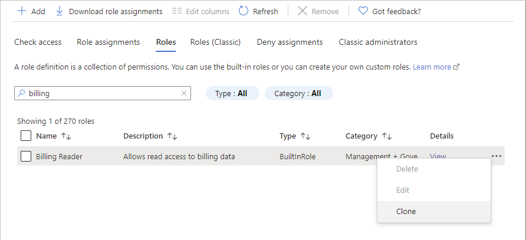
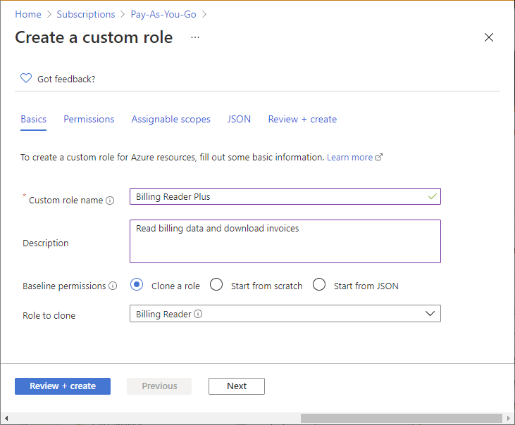
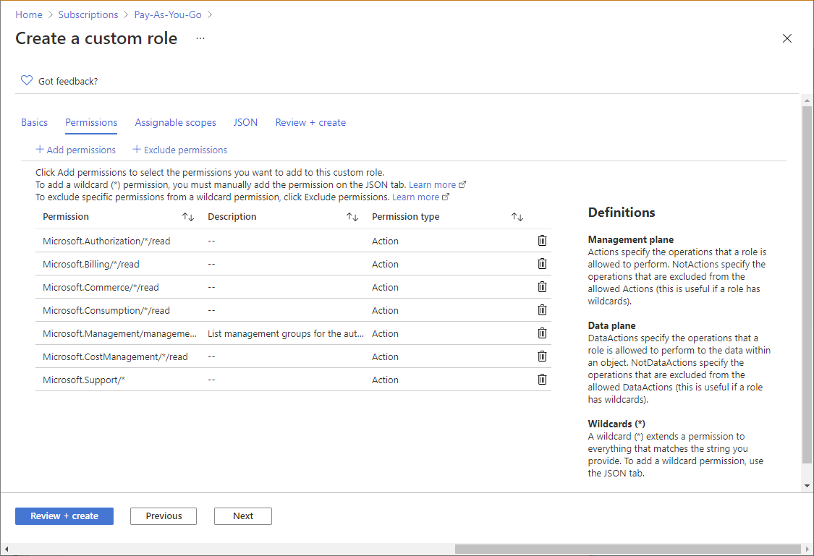
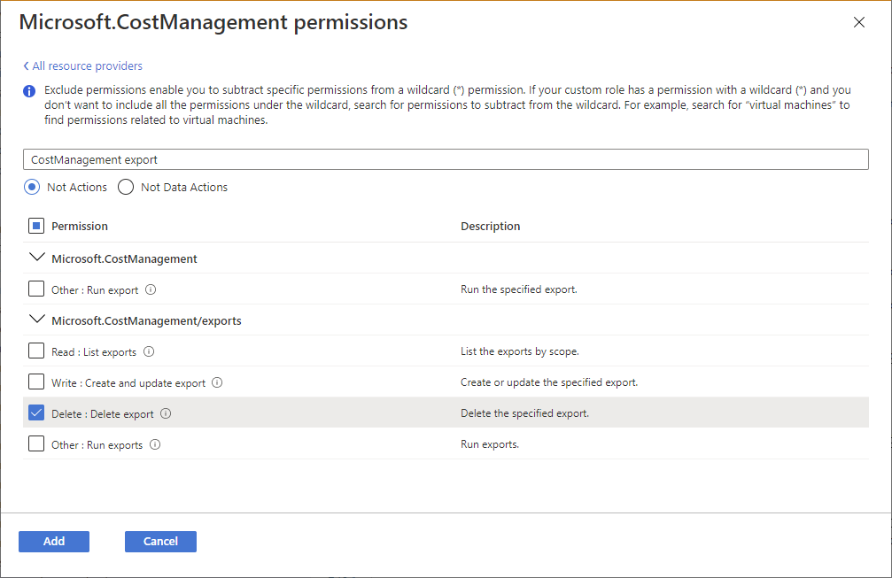
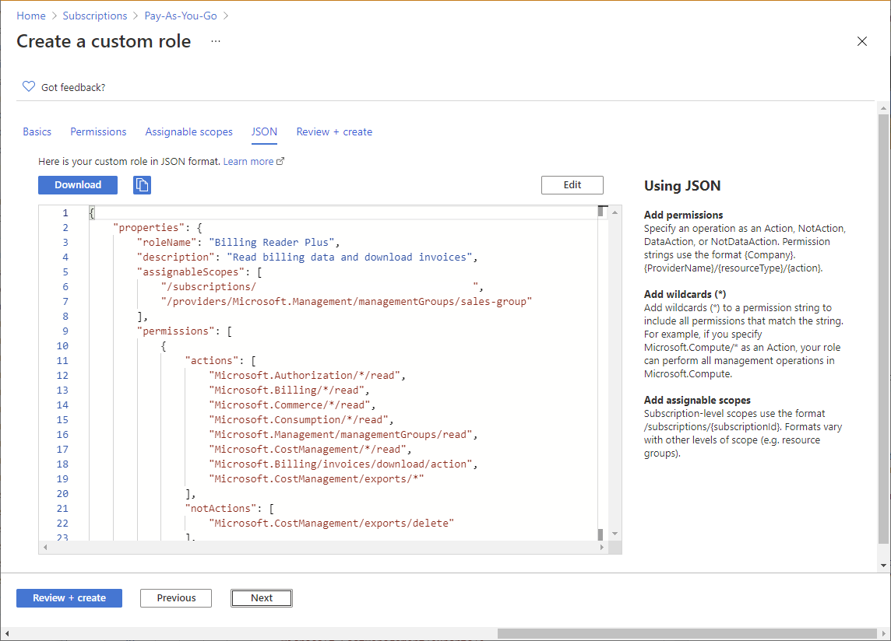
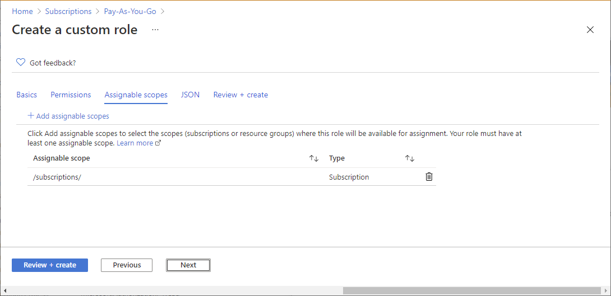
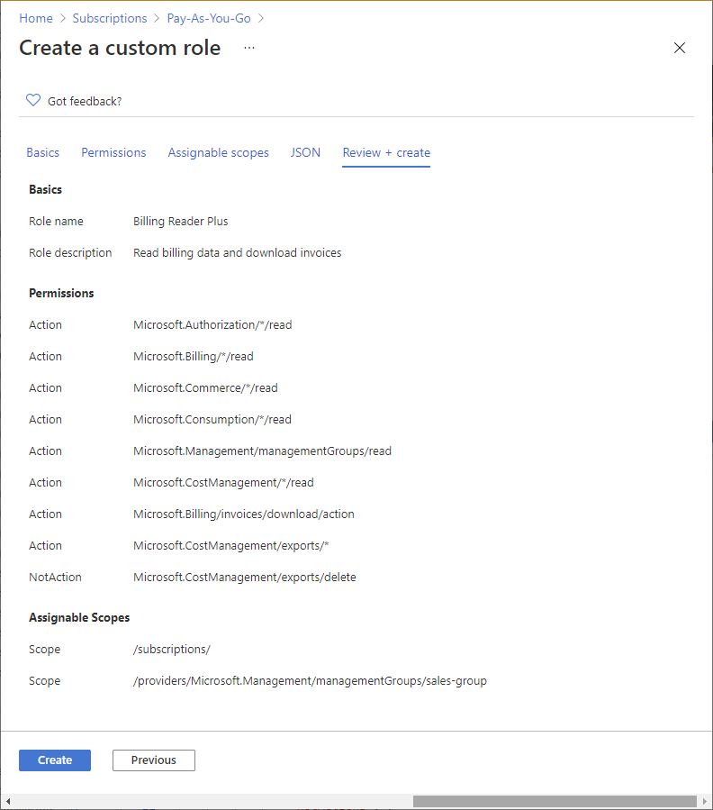

# Azure 角色的克隆与修改：创建看不到计费信息的 Contributor

当 Azure 内置角色不能完全满足需求时，可以创建自定义角色。但从零定义角色时，我们往往只知道用户需要完成什么工作，并不清楚这些工作分别需要哪些权限。例如，创建虚拟机除了计算权限，还可能涉及网络、存储和部署操作。

这时，**基于一个接近需求的已有角色进行克隆，再调整权限，通常比从头枚举所有权限更方便。** 本文以“用户需要 Contributor 的资源管理能力，但不能查看订阅费用和账单”为例，介绍在 Azure 门户中克隆 Contributor、调整权限并创建自定义角色的流程。

## 目录

- [一、为什么使用克隆](#一为什么使用克隆)
- [二、明确示例的权限目标](#二明确示例的权限目标)
- [三、操作前的准备](#三操作前的准备)
- [四、克隆 Contributor 并修改权限](#四克隆-contributor-并修改权限)

---

## 一、为什么使用克隆

Azure 角色定义的是一组允许执行的操作，例如读取资源、创建资源、删除资源或分配角色。内置角色覆盖了常见工作，但实际需求经常是“保留大部分能力，再增加或排除几项权限”。

例如：

| 实际需求 | 可考虑的起点 |
|---|---|
| 保留资源管理能力，但限制费用访问 | Contributor |
| 主要查看资源，再补充少量运维操作 | Reader 或对应服务的专用角色 |
| 管理某个服务，但排除其中的指定操作 | 对应服务的内置管理角色 |

克隆会生成一个**独立的自定义角色**，不会修改原来的内置角色，也不会复制原角色的用户分配关系。创建完成后，管理员需要另外把新角色分配给用户、组或应用。

克隆也不意味着与源角色保持同步。内置角色以后增加或调整权限时，已经创建的自定义角色不会自动重新克隆；需要定期比较和维护。对于保留了 `"*"` 的自定义角色，通配符仍可能涵盖今后新增且未被排除的操作，因此克隆只是方便的起点，不等于已经完成最小权限设计å。

相关概念见 [Azure 自定义角色](https://learn.microsoft.com/en-us/azure/role-based-access-control/custom-roles)。

---

## 二、明确示例的权限目标

本文希望创建名为 **Contributor Without Billing** 的自定义角色：

| 能力å | 目标 |
|---|---|
| 创建、修改、删除一般 Azure 资源 | 保留 Contributor 的权限 |
| 在订阅中注册资源提供程序和预览功能 | 保留；部分预览功能仍需服务方审批 |
| 给自己或其他人分配角色 | 不允许 |
| 创建、修改自定义角色 | 不允许 |
| 查看 Cost Analysis、实际费用和用量明细 | 排除主要相关接口权限，并验证访问结果 |
| 查看 MCA 账单和发票 | 不授予独立 MCA 计费角色，并清理已有授权 |

---

## 三、操作前的准备

准备以下信息：

1. 目标订阅及其 Subscription ID。
2. 需要被授权的用户或 Microsoft Entra 安全组。
3. 用于操作的管理员账号：需要在相关范围具有创建自定义角色和分配角色的权限，例如订阅 Owner。**只有 MCA Billing Account Owner 并不代表已经拥有订阅 IAM 的管理权限。**
4. 用于验收的目标账号或测试账号，确保它的其他角色不会干扰结果。

虽然示例采用 MCA 订阅，但克隆角色的入口在**订阅的访问控制（IAM）**，不是在 MCA Billing Account 中。资源权限和 MCA 计费权限是两套需要分别检查的授权。

---

## 四、克隆 Contributor 并修改权限

### 1. 从 Contributor 开始克隆

1. 登录 [Azure 门户](https://portal.azure.com)。
2. 搜索并打开 **Subscriptions（订阅）**。
3. 选择目标订阅，进入 **Access control (IAM)（访问控制）**。
4. 打开 **Roles（角色）**选项卡，搜索 `Contributor`。
5. 点击 Contributor 行右侧的 **… → Clone（克隆）**。



完整入口如下：

```text
Azure 门户
└── Subscriptions（订阅）
    └── 目标订阅
        └── Access control (IAM)
            └── Roles
                └── Contributor → … → Clone
```

### 2. 填写新角色名称

在 **Basics（基本信息）**中设置：

- **Custom role name**：`Contributor Without Billing`。
- **Description**：`Manage Azure resources without granting billing, consumption, or cost-management access.`
- **Baseline permissions**：确认使用 **Clone a role**，源角色为 Contributor。

角色名称在同一 Microsoft Entra 租户内需要唯一。



### 3. 保留 Contributor 原有的限制

进入 **Permissions（权限）**，可以查看克隆得到的权限定义。



Contributor 的管理权限主要由以下结构组成：

```text
Actions: ["*"]
NotActions: [Contributor 已经排除的操作]
```

`Actions` 中的 `"*"` 表示允许匹配的管理操作，`NotActions` 用于从中减去指定操作。**必须保留从 Contributor 克隆来的全部原有 NotActions**，尤其是限制角色管理的条目。不要用计费排除项覆盖整个原数组，否则可能重新开放原来被限制的能力。

需要排除单个具体操作时，可以点击 **Exclude permissions（排除权限）**，搜索并勾选对应操作。以下截图展示的是官方示例中排除一项操作的界面。



### 4. 在 JSON 中追加计费排除项

本例希望按资源提供程序排除主要计费能力，使用通配符更直接。在 **JSON → Edit（编辑）**中，向 `properties.permissions[0].notActions` 原有数组的末尾追加以下四个条目：

```json
[
  "Microsoft.Billing/*",
  "Microsoft.Consumption/*",
  "Microsoft.CostManagement/*",
  "Microsoft.Commerce/*"
]
```

这组配置也会限制预算、成本导出及部分计费相关管理功能。它是本例的初始排除范围，不应在未经验证时视为隐藏所有费用信息的完整保证。



下面是一份按本文编写时的 [Contributor 官方定义](https://learn.microsoft.com/en-us/azure/role-based-access-control/built-in-roles/privileged#contributor)整理的完整门户 JSON 示例，也可下载 [contributor-without-billing.portal.json](./contributor-without-billing.portal.json)。**先把 `<subscription-id>` 替换成实际订阅 ID**；如果门户克隆出的 Contributor 有更新的排除项，以当前克隆结果为基础保留，再追加计费排除项。

```json
{
  "properties": {
    "roleName": "Contributor Without Billing",
    "description": "Manage Azure resources without granting billing, consumption, or cost-management access.",
    "assignableScopes": [
      "/subscriptions/<subscription-id>"
    ],
    "permissions": [
      {
        "actions": [
          "*"
        ],
        "notActions": [
          "Microsoft.Authorization/*/Delete",
          "Microsoft.Authorization/*/Write",
          "Microsoft.Authorization/elevateAccess/Action",
          "Microsoft.Blueprint/blueprintAssignments/write",
          "Microsoft.Blueprint/blueprintAssignments/delete",
          "Microsoft.Compute/galleries/share/action",
          "Microsoft.Purview/consents/write",
          "Microsoft.Purview/consents/delete",
          "Microsoft.Resources/deploymentStacks/manageDenySetting/action",
          "Microsoft.Subscription/cancel/action",
          "Microsoft.Subscription/enable/action",
          "Microsoft.Billing/*",
          "Microsoft.Consumption/*",
          "Microsoft.CostManagement/*",
          "Microsoft.Commerce/*"
        ],
        "dataActions": [],
        "notDataActions": []
      }
    ]
  }
}
```

### 5. 确认可分配范围并创建

在 **Assignable scopes（可分配范围）**中确认目标订阅，编辑 JSON 后也要核对这里的范围。



可分配范围表示“这个角色可以在哪里使用”，**不会自动给任何用户授权**。

完成设置后，在 **Review + create（查看 + 创建）**中核对角色名称、权限和范围，再点击 **Create（创建）**。如果刚创建的角色未立即出现在列表中，等待几分钟并刷新。


