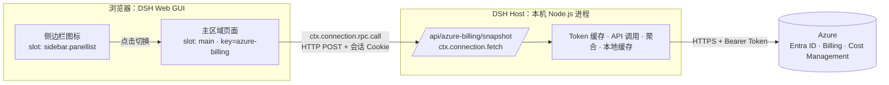
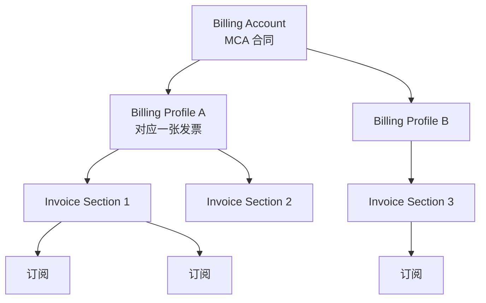
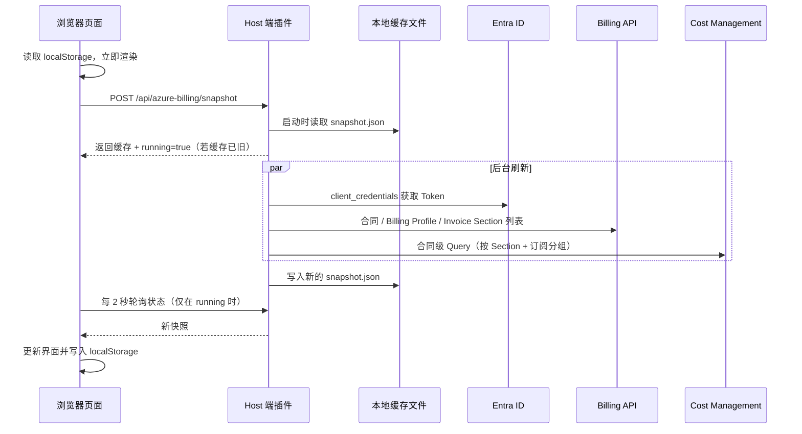
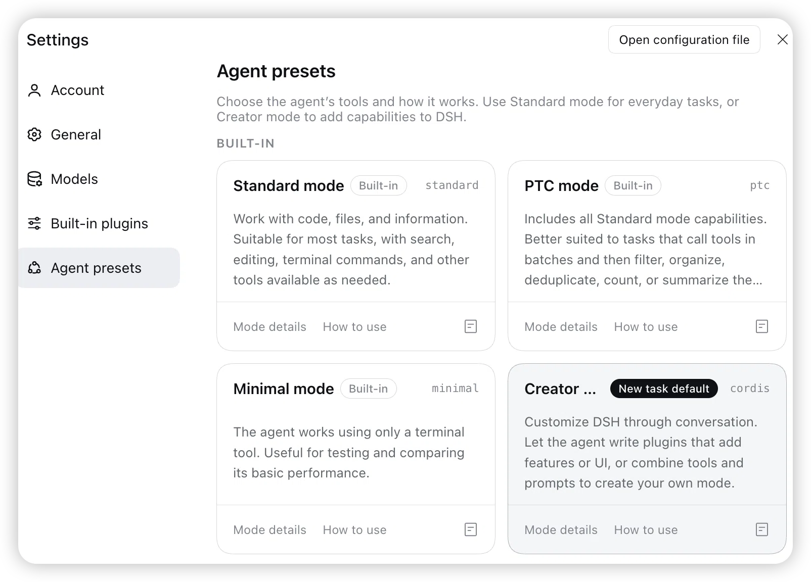
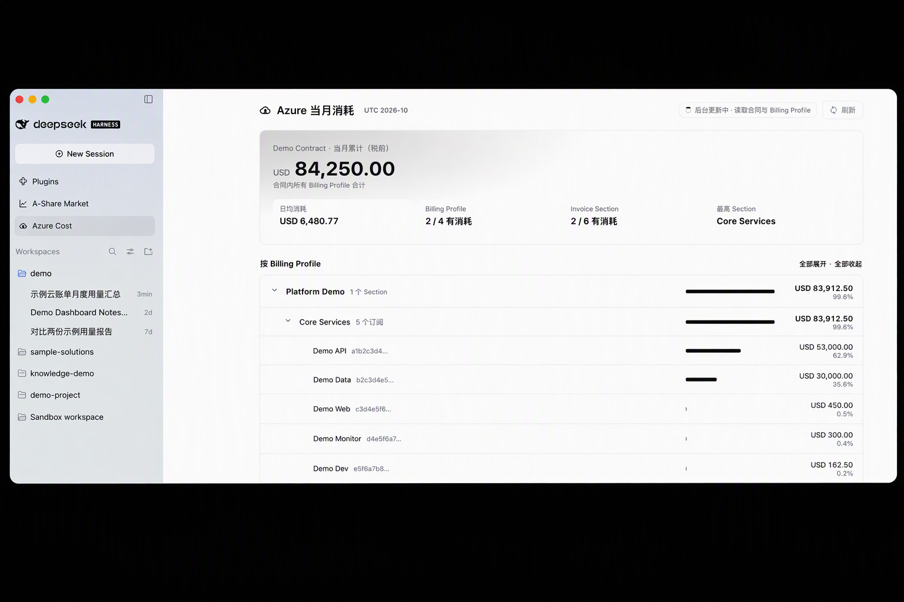

# DeepSeek Harness 插件实践-在侧边栏做Azure 成本看板

最近一位朋友向我推荐了 DeepSeek Harness 的插件功能。上手试了一下，体验很好：不用自己翻文档、搭框架，只要在对话里把想要的功能说清楚，Agent 就能把插件写好、装好，直接出现在侧边栏里。于是我拿一个工作中一直想要的小工具——Azure 成本看板——完整走了一遍，整理成这篇文章。

DeepSeek Harness（下文简称 DSH）是一个以插件组合起来的 Agent 运行环境：模型调用、工具、会话、Web 界面乃至侧边栏里的每一个图标，都是一个个插件。既然官方功能也是插件，我们自己写的插件就能和它们处在同一层级——在侧边栏加一个入口、在主区域渲染一个页面、在后端调用外部 API。

本文以一个真实需求为例：**在 DSH 侧边栏里查看 Azure MCA 合同当月的消耗**，按 Billing Profile → Invoice Section → 订阅三级展开。文章依次说明：

- DSH 插件是什么，由哪些文件组成，如何被加载；
- “侧边栏里的一个页面”实际上由哪几部分组成，Host 端和浏览器端各做什么、怎样通信；
- 获取 MCA 账单信息需要哪些 Azure REST API，为什么最后只用一次费用查询；
- 如何在 Creator 模式下通过对话完成整个插件，以及插件的关键实现。

> **重点：本文的插件不需要手写。** 先在 DSH 设置里启用 **Creator 模式**，再把需求在聊天框里用自然语言说出来，Agent 会自己查阅 DSH 的运行时、编写插件、安装、调用 Azure 验证，一步步完成。后文的原理和代码，是为了帮助你理解 Agent 做了什么、以及如何检查它的结果。具体做法见[第四节](#四先启用-creator-模式再用对话完成)。

## 目录

- [一、DSH 插件是什么](#一dsh-插件是什么)
- [二、侧边栏里的一个页面，实际由什么组成](#二侧边栏里的一个页面实际由什么组成)
- [三、示例需求与整体架构](#三示例需求与整体架构)
- [四、先启用 Creator 模式，再用对话完成](#四先启用-creator-模式再用对话完成)
- [五、获取 MCA 账单信息的 Azure API](#五获取-mca-账单信息的-azure-api)
- [六、插件实现](#六插件实现)

---

## 一、DSH 插件是什么

### 1.1 一切都是 Cordis 插件

DSH 基于 Cordis 插件框架。一个插件就是一个导出 `apply(ctx, config)` 的模块，`ctx` 是插件的上下文，通过它可以拿到其他插件提供的**服务（Service）**，例如：

| 服务 | 所在端 | 用途 |
| --- | --- | --- |
| `ctx.connection` | Host | 注册 `/api` 下的 HTTP 路由，供浏览器调用 |
| `ctx.webServer` | Host | Web GUI 使用的 HTTP 服务器 |
| `ctx.slots` | 浏览器 | 往界面上的“插槽”里注册 React 组件 |
| `ctx.locale` | 浏览器 | 注册多语言文案 |
| `ctx.connection.rpc` | 浏览器 | 调用 Host 端的接口 |

插件通过 `inject` 声明依赖哪些服务，框架保证这些服务就绪后才调用 `apply`。插件在 `apply` 中注册的东西（路由、组件、样式）都通过 `ctx.effect` 绑定生命周期，插件被禁用或重载时自动撤销。

> 想知道当前运行时到底有哪些服务、方法签名是什么、界面上有哪些插槽，可以在 DSH 会话里让 Agent 调用 `cordis_inspect_list` / `cordis_inspect_query`，它们会读取正在运行的 Host 与浏览器。本文用到的服务和插槽都是这样查出来的。

### 1.2 Profile、Bundle 与 patch

DSH 的“安装哪些插件、如何配置”记录在一个 **Profile** 目录里（例如 `~/.dsh/profiles/desktop/`）：

```text
~/.dsh/profiles/desktop/
├── package.json        # 依赖了哪些插件包；dsh.profile.bundles 声明启用哪些 bundle
├── cordis.yml          # 根配置（通常为空数组，不要直接改）
├── cordis.patch.yml    # 你自己的配置层：覆盖某个插件的 config、启用/禁用
└── node_modules/       # pnpm 安装出来的插件包
```

一个插件包可以是一个 **Bundle**：包里自带一份 `cordis.patch.yml`，声明“把我插入到插件树中”。Profile 加载时按顺序合并：各 Bundle 的 patch → Profile 自己的 `cordis.patch.yml`。因此：

- 插件包里只写“插入我”，不写任何密钥；
- 账号、密钥这类个人配置写在 Profile 的 `cordis.patch.yml` 中，用同一个 `id` 覆盖 `config`。

### 1.3 一个插件包的最小结构

```text
azure-billing-plugin/
├── package.json
├── cordis.patch.yml
└── lib/
    ├── index.js     # Host 端入口（Node.js）
    └── client.js    # 浏览器端入口
```

`package.json` 中的 `dsh` 字段告诉 DSH 这是一个带浏览器端的 Bundle：

```json
{
  "name": "dsh-azure-billing",
  "type": "module",
  "main": "lib/index.js",
  "exports": {
    ".": "./lib/index.js",
    "./client": "./lib/client.js",
    "./package.json": "./package.json",
    "./cordis.patch.yml": "./cordis.patch.yml"
  },
  "dsh": {
    "client": {
      "platform": "web",
      "inject": [
        "@deepseek-ai/dsh-client-locale",
        "@deepseek-ai/dsh-client-connection",
        "@deepseek-ai/dsh-client-ui-layout",
        "@deepseek-ai/dsh-client-ui-sidebar"
      ]
    },
    "bundle": { "patch": "./cordis.patch.yml" }
  },
  "peerDependencies": { "@deepseek-ai/cordis": "~4.0.4" }
}
```

| 字段 | 含义 |
| --- | --- |
| `exports["."]` | Host 端入口，在 DSH 的 Node.js 进程里运行 |
| `exports["./client"]` | 浏览器端入口，由 DSH 打包后发给页面 |
| `dsh.client.inject` | 浏览器端依赖的官方客户端插件（多语言、连接、布局、侧边栏） |
| `dsh.bundle.patch` | 插件自带的 patch，把自己插入插件树 |

包内的 `cordis.patch.yml` 只有几行：

```yaml
- insert:
    - id: azure-billing
      name: 'dsh-azure-billing'
```

---

## 二、侧边栏里的一个页面，实际由什么组成

### 2.1 两个进程、两个半边

在 DSH 的 Web GUI 中点击侧边栏的一个图标，看起来只是“打开了一个页面”，但背后至少有两个运行环境：



| 部分 | 运行位置 | 职责 | 本例文件 |
| --- | --- | --- | --- |
| **Host 端**（Host half） | DSH 本机进程（Node.js） | 持有密钥、访问外部服务、读写本地文件、提供接口 | `lib/index.js` |
| **浏览器端**（Client half） | DSH Web GUI 页面 | 注册侧边栏图标与页面、渲染 UI、调用 Host 接口 | `lib/client.js` |

“侧边栏”本身是官方插件 `dsh-client-ui-sidebar` 提供的一个**插槽**。插槽就是界面上预留的位置，任何插件都可以往里注册组件：

| 插槽 | 类型 | 本例用法 |
| --- | --- | --- |
| `sidebar.panellist` | list（列表） | 注册一个图标，`id: "azure-billing"` |
| `main` | keyed（按 key 选择） | 注册 `key: "azure-billing"` 的页面组件；点击图标后主区域按这个 key 渲染 |

也就是说，“侧边栏入口”= 往 `sidebar.panellist` 放一个图标 + 往 `main` 放一个同 id 的页面。

### 2.2 为什么必须有 Host 端

只写浏览器端也能做一些插件（例如调用支持 CORS 的公开行情接口）。但本例不行：

1. **密钥不能进浏览器。** 服务主体的 Client Secret 一旦下发到页面，任何能打开页面的人都能拿到。
2. **CORS。** `login.microsoftonline.com` 的 client_credentials 流程不允许浏览器跨域调用。
3. **限流与缓存需要集中。** 多个标签页同时打开，不应各自去打 Azure；Host 端统一缓存、统一冷却。
4. **持久化。** 本地缓存文件只能由 Host 写。

所以 Host 端负责“和 Azure 打交道”，浏览器端只拿“已经聚合好的结果”。

### 2.3 浏览器端如何调用 Host 端

DSH 的连接插件 `dsh-client-connection` 已经提供了安全的通道，插件不需要自己起 HTTP 服务：

- **Host 端**：`ctx.connection.fetch.register({ path: "/api/...", methods, fetch })` 在 `/api` 下注册一个精确路由。所有 `/api` 请求在到达插件之前，已经经过 DSH 的 Host/Origin 校验和浏览器会话 Cookie 认证。
- **浏览器端**：`ctx.connection.rpc.call("/api", "azure-billing/snapshot", payload)` 会 `POST /api/azure-billing/snapshot`，请求体是 `{ type: "client-request", rpcId, method, payload }`，并校验响应的 `rpcId`。

Host 返回的响应需要符合同样的信封格式：

```json
{ "type": "server-response", "rpcId": "<原样返回>", "result": { "ok": true, "value": { ... } } }
```

这一层的好处是：认证、跨站防护、桌面版与 Web 版的传输差异都由 DSH 处理，插件只关心业务数据。

### 2.4 浏览器端代码的形态

浏览器端入口不是普通 ES 模块，而是交给 DSH 模块加载器的工厂函数，React 等依赖通过 `require` 从宿主取得：

```js
window.__ModuleLoader__.load({
  id: "dsh-azure-billing",
  factory: (require) => {
    const React = require("react");
    const h = React.createElement;
    // ... 组件定义 ...
    function apply(ctx) {
      ctx.slots.inject("main", () =>
        ctx.slots.register({ name: "main", key: "azure-billing", locale: NS }, Page));
      ctx.slots.inject("sidebar.panellist", () =>
        ctx.slots.register({ name: "sidebar.panellist", id: "azure-billing", order: 21,
          locale: NS, label: () => t("panel") }, CloudIcon));
    }
    return { apply, inject: ["slots", "locale", "layout", "connection"] };
  },
});
```

样式使用 DSH 的主题变量（如 `--dsw-alias-bg-layer-1`、`--dsw-alias-label-secondary`、`--dsw-alias-brand-primary`），浅色与深色主题自动适配。可用变量同样可以通过 `cordis_inspect_query` 的 `Theme.listTokens` 查询。

---

## 三、示例需求与整体架构

### 3.1 需求

- 在 DSH 侧边栏增加“Azure 消耗”入口；
- 页面默认只显示每个 **Billing Profile** 的当月费用；点开看 **Invoice Section**，再点开看**订阅**；
- 打开页面立即显示上次的数据，后台拉取新数据后自动刷新。

在 Creator 模式下，把以上需求按下文[第四节](#四先启用-creator-模式再用对话完成)的方式在聊天框里逐条说出来，Agent 即可一步步完成。

### 3.2 MCA 的计费层级

Microsoft 客户协议（MCA）下的计费对象是一棵树：



- **Billing Profile**：开票维度，每个 Profile 每月生成一张发票，有自己的币种和付款方式；
- **Invoice Section**：发票内的分组，常用来区分部门或项目；
- **订阅**：资源的承载单位，归属于某个 Invoice Section。

### 3.3 数据流



---

## 四、先启用 Creator 模式，再用对话完成

### 4.1 启用 Creator 模式

DSH 的 Agent 有多种预设（Agent presets），决定 Agent 拥有哪些工具。默认的 Standard 模式适合日常编码和文件处理；要让 Agent 为 DSH 自身编写插件、添加界面，需要在 **Settings → Agent presets** 中启用 **Creator 模式**。



Creator 模式下，Agent 额外具备查看正在运行的 DSH 的能力：可以列出 Host 与浏览器端的服务、方法签名、界面插槽、主题变量，也可以管理插件。正因为能直接读取运行时，Agent 写出的插件会使用真实存在的接口，而不是凭经验猜测。

### 4.2 用对话把需求说出来

启用 Creator 模式后，在聊天框里按需求依次描述即可。本文的看板就是通过下面几轮对话完成的：

| 轮次 | 在聊天框里说的话 | Agent 完成的事情 |
| --- | --- | --- |
| 1 | “你看看 billing 文件夹里的内容理解下。我期望用 REST API 获取 Azure MCA 合同下，Billing Profile、Invoice Section 的当月 Azure 消耗” | 阅读已有脚本，梳理出 Token、Billing API、Cost Management Query 的调用方式 |
| 2 | “创建一个 DSH 的插件，来展示当月 Azure 消耗，放到 sidebar” | 查询运行时的服务与插槽，编写 Host 端与浏览器端，安装到 Profile，并用真实 Azure 数据验证 |
| 3 | “每次查询把数据保存在本地，下次加载直接用，等新数据拉下来再刷新。另外优化界面，使其更漂亮” | 增加 Host 端文件缓存与浏览器端缓存，重新设计页面 |
| 4 | “一次 API 调用能看到每个订阅的费用吗” | 实测按订阅分组的查询，确认可行 |
| 5 | “界面上只看到 Profile 的费用，然后有下拉效果，看到 Invoice Section，再下拉有订阅的费用” | 改为三级折叠列表 |

几点经验：

- **一次只提一个目标。** 先跑通，再优化性能，再美化界面，每轮都能看到结果。
- **遇到问题直接贴截图。** 例如页面一直转圈，截图加一句“查了很久”，Agent 会自己去排查原因。
- **让 Agent 先验证再交付。** Agent 会在 DSH 之外先调用真实 API 核对金额，再装进 DSH；你只需要刷新页面查看效果。
- **密钥交给配置文件。** 可以告诉 Agent 凭据放在哪里（例如已有脚本或环境变量），它会把密钥写入 Profile 配置，而不是插件代码。

下文各节解释这个插件的结构与原理。即使全部由 Agent 完成，理解这些内容也有助于你判断结果是否正确、以后如何修改。

---

## 五、获取 MCA 账单信息的 Azure API

### 5.1 身份与权限

| 项 | 设置 |
| --- | --- |
| 身份 | Entra ID 应用注册（服务主体），使用 Client Secret |
| Token 端点 | `POST https://login.microsoftonline.com/{tenantId}/oauth2/v2.0/token` |
| grant_type | `client_credentials` |
| scope | `https://management.azure.com/.default` |
| 计费权限 | 在 MCA **Billing Account** 级别分配 **Billing account reader** |

注意计费权限是在“成本管理 + 计费”的计费范围上分配的，不是订阅 RBAC。只给订阅 Reader 无法读取 Billing Profile 和 Invoice Section。

```bash
curl -s -X POST "https://login.microsoftonline.com/$TENANT_ID/oauth2/v2.0/token" \
  -d grant_type=client_credentials \
  -d client_id="$CLIENT_ID" \
  -d client_secret="$CLIENT_SECRET" \
  -d scope=https://management.azure.com/.default
```

### 5.2 Billing API：读取层级结构（api-version 2024-04-01）

| 用途 | 请求 |
| --- | --- |
| 合同信息（显示名称） | `GET /providers/Microsoft.Billing/billingAccounts/{acct}?api-version=2024-04-01` |
| Billing Profile 列表 | `GET /providers/Microsoft.Billing/billingAccounts/{acct}/billingProfiles?api-version=2024-04-01&includeDeleted=true` |
| 某 Profile 下的 Invoice Section | `GET .../billingProfiles/{profileName}/invoiceSections?api-version=2024-04-01&includeDeleted=true` |

要点：

- `{acct}` 是 MCA 的 Billing Account ID，形如 `xxxxxxxx-...:xxxxxxxx-..._2019-05-31`，路径中需要 URL 编码；
- `includeDeleted=true` 保留本月内被删除的 Profile/Section，否则它们本月已经产生的费用会“无处归属”；
- 列表接口可能分页，按 `nextLink` 继续读取；
- 返回的 `name` 是资源 ID 的最后一段（Invoice Section 通常是 GUID），`properties.displayName` 是界面显示名。

### 5.3 Cost Management Query：读取费用（api-version 2025-03-01）

```http
POST https://management.azure.com/providers/Microsoft.Billing/billingAccounts/{acct}/providers/Microsoft.CostManagement/query?api-version=2025-03-01
Content-Type: application/json

{
  "type": "ActualCost",
  "timeframe": "MonthToDate",
  "dataset": {
    "granularity": "None",
    "aggregation": { "totalCost": { "name": "PreTaxCost", "function": "Sum" } },
    "grouping": [
      { "type": "Dimension", "name": "InvoiceSectionId" },
      { "type": "Dimension", "name": "SubscriptionId" },
      { "type": "Dimension", "name": "SubscriptionName" }
    ]
  }
}
```

| 参数 | 取值 | 说明 |
| --- | --- | --- |
| `type` | `ActualCost` | 实际成本，与发票口径一致；`AmortizedCost` 会把预留实例等摊销 |
| `timeframe` | `MonthToDate` | 当月 1 日至今，按 UTC |
| `granularity` | `None` | 不按天拆分，直接汇总 |
| `aggregation` | `Sum(PreTaxCost)` | 税前成本 |
| `grouping` | 最多两三个维度 | 决定返回的每一行代表什么 |

返回的 `properties.columns` 描述列，`rows` 是二维数组，例如：

```json
{
  "columns": [
    { "name": "PreTaxCost", "type": "Number" },
    { "name": "InvoiceSectionId", "type": "String" },
    { "name": "SubscriptionId", "type": "String" },
    { "name": "SubscriptionName", "type": "String" },
    { "name": "Currency", "type": "String" }
  ],
  "rows": [
    [1234.56, "<section-guid>", "<subscription-guid>", "Subscription 05", "USD"]
  ],
  "nextLink": null
}
```

**不要按列位置硬编码**，应按 `columns[].name` 找到费用列和币种列。`Currency` 列会自动附带。

`scope` 也可以换成单个 Profile（`.../billingProfiles/{bp}`）或单个 Section（`.../invoiceSections/{is}`），查询体相同。

---

## 六、插件实现

### 6.1 Host 端：`lib/index.js`

Host 端是一个普通的 ES 模块，导出 `inject` 和 `apply`：

```js
export const inject = ["connection"];

export function apply(ctx, config) {
  const cfg = {
    tenantId: config.tenantId || process.env.AZURE_TENANT_ID,
    clientId: config.clientId || process.env.AZURE_CLIENT_ID,
    clientSecret: config.clientSecret || process.env.AZURE_CLIENT_SECRET,
    billingAccountId: config.billingAccountId || process.env.AZURE_BILLING_ACCOUNT_ID,
  };
  // ... Token 缓存、刷新任务、本地缓存 ...

  ctx.connection.fetch.register({
    path: "/api/azure-billing/snapshot",
    methods: ["POST"],
    requestBody: "buffered",
    async fetch(request) {
      const message = await request.json();
      // 缓存过旧或用户强制刷新时，在后台启动一次刷新（不阻塞响应）
      maybeStartRefresh(message.payload?.force);
      return Response.json({
        type: "server-response",
        rpcId: message.rpcId,
        result: { ok: true, value: state() },
      });
    },
  });
}
```

几个关键设计：

| 设计 | 做法 |
| --- | --- |
| Token 缓存 | 按 `expires_in` 缓存，提前 2 分钟过期；遇到 401 清空后重试一次 |
| 单任务刷新 | 同一时刻只有一个刷新 Promise；接口立即返回当前状态和 `running` 标志 |
| 进度 | 刷新过程中更新 `stage` 文案，浏览器轮询时一并显示 |
| 聚合 | 用 Section ID（小写）建索引；费用同时累加到订阅、Section、Profile；匹配不上的进入“未归属”节点 |
| 多币种 | 每层都以 `{ 币种: 金额 }` 汇总，不混加 |
| 本地缓存 | 成功后写 `$DSH_HOME/storages/azure-billing/snapshot.json`（先写临时文件再 rename，权限 0600），只含费用数据 |
| 生命周期 | 进行中的请求用 `AbortController` 绑定到 `ctx.effect`，插件卸载时自动中止 |

聚合核心逻辑：

```js
const bySection = new Map();
for (const p of profiles) for (const s of p.sections) bySection.set(s.id.toLowerCase(), { p, s });

for (const r of rows) {           // rows 来自一次分组查询
  const hit = bySection.get(String(r.InvoiceSectionId).toLowerCase());
  if (hit) {
    add(hit.p.cost, r.currency, r.cost);
    add(hit.s.cost, r.currency, r.cost);
    add(subscriptionOf(hit.s, r).cost, r.currency, r.cost);
  } else {
    add(unmatched.cost, r.currency, r.cost);
  }
}
```

### 6.2 浏览器端：`lib/client.js`

| 功能 | 做法 |
| --- | --- |
| 秒开 | 初始状态从 `localStorage` 读取上一次快照，先渲染 |
| 后台更新 | 首次挂载调用一次接口；当返回 `running: true` 时每 2 秒轮询，完成后停止 |
| 有新数据 | `fetchedAt` 变化时更新界面、写回 `localStorage`，汇总卡片闪烁提示 |
| 三级展开 | 用一个 `Set` 记录展开的节点 key（`p:<id>`、`p:<id>/s:<id>`），点击切换；支持键盘回车/空格 |
| 排序与占比 | 同级按金额降序，每行显示占合同总额的百分比和比例条 |
| 状态提示 | 右上角状态胶囊：后台更新中（含阶段）、更新于 x 分钟前、更新失败（显示缓存） |
| 主题 | 只使用 DSH 主题变量，自动适配深浅色 |

页面效果：



---

## 小结

DSH 插件的“侧边栏页面”并不只是一段前端代码：浏览器端通过插槽把图标和页面挂到界面上，Host 端在本机进程中持有凭据、调用外部服务，两者通过 DSH 已经做好认证的 `/api` 通道通信。按这个分工，就能把任何“需要密钥、需要缓存、需要后台调用”的内部工具搬进 DSH。

对于 Azure MCA 成本这类场景，关键是先摸清 Billing API 与 Cost Management Query 的分工和限流：用 Billing API 读结构，用**一次合同级分组查询**读费用，再在本地聚合成 Profile → Section → 订阅三级视图。
